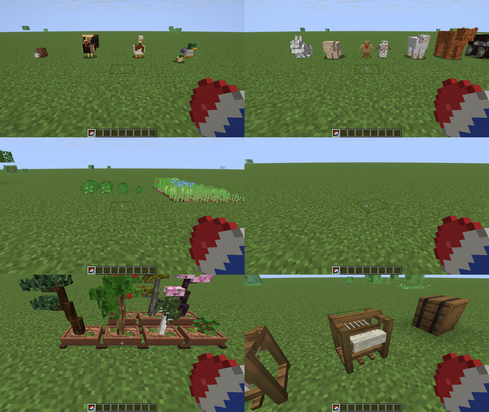

# Pobieranie (NeoForge 26.2)

- [gospodarstwo-0.1.0.jar](gospodarstwo-0.1.0.jar) – Swojskie Gospodarstwo
- [animalbonds-0.1.0.jar](animalbonds-0.1.0.jar) – Animal Bonds
- [elementals-0.1.0.jar](elementals-0.1.0.jar) – Żywiołaki

Wrzuć pliki do folderu mods. Każdy mod działa też osobno. GeckoLib jest opcjonalny.

